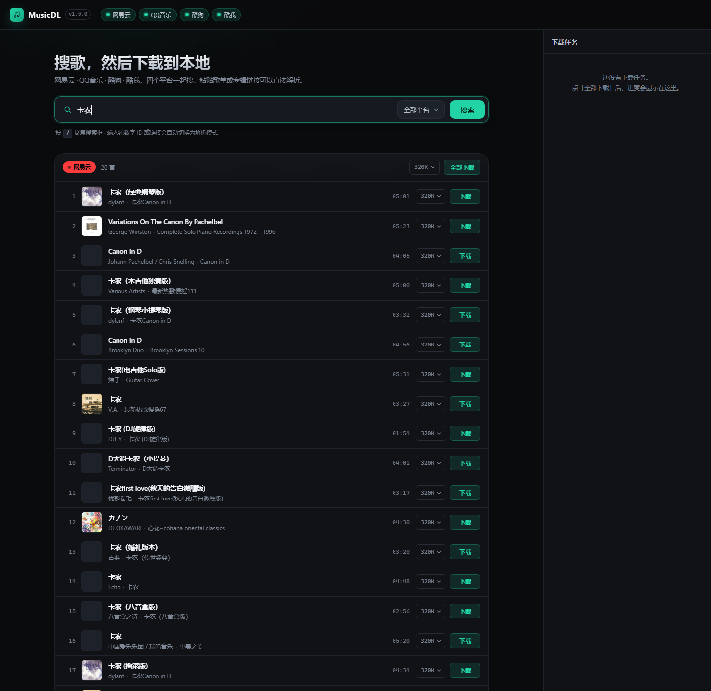

# MusicDL

多平台音乐解析下载器 —— 粘贴一条歌曲 / 歌单 / 专辑链接，解析出曲目并下载到本地，自动写入封面与歌词标签。

支持 **网易云音乐 · QQ音乐 · 酷狗音乐 · 酷我音乐** 四个平台，带 Web 界面和命令行两套入口。



```
┌──────────────┐   ┌──────────────┐   ┌──────────────┐   ┌──────────────┐
│   网易云      │   │   QQ 音乐     │   │    酷狗       │   │    酷我       │
└──────┬───────┘   └──────┬───────┘   └──────┬───────┘   └──────┬───────┘
       └──────────────────┴──────────────────┴──────────────────┘
                                  │
                        ┌─────────▼─────────┐
                        │  Registry 统一抽象  │
                        │ search / resolve  │
                        │ stream / lyric    │
                        └─────────┬─────────┘
                                  │
                    ┌─────────────┴─────────────┐
                    │                           │
              ┌─────▼─────┐              ┌──────▼──────┐
              │  Web UI   │              │     CLI     │
              │ FastAPI   │              │    mdl      │
              └───────────┘              └─────────────┘
```

## 快速开始

```bash
git clone <this-repo> musicdownloader
cd musicdownloader

python -m venv .venv
# Windows
.venv\Scripts\activate
# Linux / macOS
source .venv/bin/activate

pip install -e .
mdl serve --port 8000
```

打开 <http://127.0.0.1:8000> ，输入歌名搜索，或者把链接直接粘进搜索框。

命令行同样可用：

```bash
# 搜索（四平台聚合）
mdl search "晴天 周杰伦"

# 只搜某个平台，取 5 条
mdl search "晴天" -p netease -n 5

# 用链接下载
mdl dl "https://music.163.com/song?id=5257138"

# 用平台 id 下载，指定音质
mdl dl -p netease -i 5257138 -q 320

# 关键词直接下第一条
mdl dl -p kugou -k "Canon 钢琴" -q 128
```

## 支持的链接

| 平台 | 链接形态 | 说明 |
| --- | --- | --- |
| 网易云 | `music.163.com/song?id=xxx` | 单曲 |
| 网易云 | `music.163.com/playlist?id=xxx` | 歌单，整单展开 |
| 网易云 | `music.163.com/album?id=xxx` | 专辑，整张展开 |
| 网易云 | `music.163.com/discover/toplist?id=xxx` | 榜单 |
| QQ音乐 | `y.qq.com/n/ryqq/songDetail/<mid>` | 单曲 |
| QQ音乐 | `i.y.qq.com/v8/playsong.html?songmid=<mid>` | 单曲 |
| 酷狗 | `kugou.com/song/#hash=<32位hash>` | 单曲 |
| 酷狗 | `t1.kugou.com/xxx` 短链 | 跟随跳转后识别 |
| 酷我 | `kuwo.cn/play_detail/<rid>` | 单曲 |

分享文案也能直接粘：`分享周杰伦的单曲《晴天》: https://music.163.com/song?id=186016 (来自@网易云音乐)` —— 会自动抽出 URL。

## 功能

搜索聚合四平台、链接解析（单曲 / 歌单 / 专辑）、批量下载（并发 + 任务进度）、音质选择（128 / 192 / 320 / FLAC）、ID3 标签写入（标题 / 歌手 / 专辑 / 封面 / 歌词）、歌词 LRC 文件、文件名模板、下载目录模板、断点重试、Windows 非法字符清洗、同名文件自动去重。

## 音质与版权

音质档位按平台实际能力回落：请求 320 但平台只给 128 时，会如实返回 128 并标注在结果里。拿不到直链的曲目（付费、会员、下架、地区限制）会返回明确的失败原因，不会静默生成空文件。

实测结论（2026-10，匿名态）：

- **网易云**：搜索、歌词、封面全通；免费曲目给 320k 完整文件，付费曲目只有试听片段或 404。
- **QQ音乐**：搜索、详情、歌词全通；vkey 直链对匿名请求返回空 `purl`，需要登录 Cookie 才有直链。
- **酷狗**：免费曲目直接给完整 mp3（128k），搜索/歌词/封面全通。
- **酷我**：搜索、封面通；匿名态多数曲目只返回约 16KB 试听片段，代码会识别并明确报错。

需要解锁更高音质或更多版权时，填对应平台的 Cookie：

```bash
# Windows PowerShell
$env:MDL_NETEASE_COOKIE="MUSIC_U=xxxxx; __csrf=yyyyy"
$env:MDL_QQ_COOKIE="uin=o123456; qm_keyst=xxxxx"
$env:MDL_KUGOU_COOKIE="kg_mid=xxx; kg_dfid=yyy"
$env:MDL_KUWO_COOKIE="kw_token=xxx"
mdl serve
```

Cookie 从浏览器开发者工具 → Application → Cookies 里复制，属于敏感凭据，别提交进仓库（`.gitignore` 已排除 `.env` 和 `cookies.json`）。

## 配置

全部走环境变量，都有默认值：

| 变量 | 默认 | 说明 |
| --- | --- | --- |
| `MDL_DOWNLOAD_DIR` | `downloads` | 下载根目录 |
| `MDL_CONCURRENCY` | `3` | 批量并发数 |
| `MDL_PROXY` | 空 | HTTP 代理，如 `http://127.0.0.1:7890` |
| `MDL_FILENAME_TEMPLATE` | `{artist} - {title}` | 文件名模板，可用 `{artist}` `{title}` `{album}` `{index}` `{provider}` |
| `MDL_SUBDIR_TEMPLATE` | 空 | 子目录模板，如 `{artist}` 或 `按歌手/{artist}` |
| `MDL_NETEASE_COOKIE` | `os=pc; appver=2.9.7` | 网易云 Cookie |
| `MDL_QQ_COOKIE` | 空 | QQ音乐 Cookie |
| `MDL_KUGOU_COOKIE` | 空 | 酷狗 Cookie |
| `MDL_KUWO_COOKIE` | 空 | 酷我 Cookie |

## HTTP API

服务起来后所有接口都在同源下：

| 方法 | 路径 | 说明 |
| --- | --- | --- |
| GET | `/api/health` | 健康检查 + 平台列表 |
| GET | `/api/search?q=&provider=&limit=` | 聚合搜索，`provider=all` 时并行查四家 |
| POST | `/api/resolve` | `{"url": "..."}` 解析链接 |
| POST | `/api/download` | 下载单曲，同步返回文件信息 |
| POST | `/api/download/batch` | 批量下载，返回 `job_id` |
| GET | `/api/jobs/{id}` | 轮询任务进度 |
| GET | `/api/file?path=` | 取下载目录内的文件（限制在下载根目录内） |

```bash
curl "http://127.0.0.1:8000/api/search?q=晴天&provider=netease&limit=5"
curl -X POST http://127.0.0.1:8000/api/resolve \
     -H "Content-Type: application/json" \
     -d '{"url":"https://music.163.com/song?id=5257138"}'
curl -X POST http://127.0.0.1:8000/api/download \
     -H "Content-Type: application/json" \
     -d '{"provider":"netease","id":"5257138","title":"屋顶","quality":"320"}'
```

## 项目结构

```
src/mdl/
  config.py            配置与 Cookie
  models.py            Track / StreamInfo / ResolveResult
  http.py              共享 httpx 客户端，重试与超时
  naming.py            文件名与目录模板
  tagger.py            ID3 / MP4 / FLAC 标签写入
  downloader.py        下载引擎 + 批量任务管理
  server.py            FastAPI 路由
  cli.py               命令行入口
  providers/
    base.py            Provider 抽象基类
    netease.py         网易云
    qq.py              QQ音乐
    kugou.py           酷狗
    kuwo.py            酷我
    __init__.py        Provider 注册表 + 链接自动识别
  web/
    index.html         单页界面
    app.css
    app.js
tests/
  test_offline.py      离线单测：链接识别、命名、模型
  test_api.py          API 层测试（桩替换网络）
  test_live.py         联网集成测试（pytest -m live）
```

## 测试

```bash
# 离线测试，秒级
pytest tests/test_offline.py tests/test_api.py -q

# 联网测试，真实打四个平台
pytest tests/test_live.py -q -m live
```

## 开发

```bash
pip install -e ".[dev]"
uvicorn mdl.server:app --reload --port 8000
```

新增平台：继承 `providers/base.py` 的 `Provider`，实现 `search` / `track_from_id` / `stream`（歌词可选），然后在 `providers/__init__.py` 的 `PROVIDER_CLASSES` 里注册，并在 `_HOST_RULES` 加上域名特征即可。

## 说明

仅供个人学习与本地备份使用。音乐版权归各平台与版权方所有，下载的内容请勿用于传播或商业用途。
