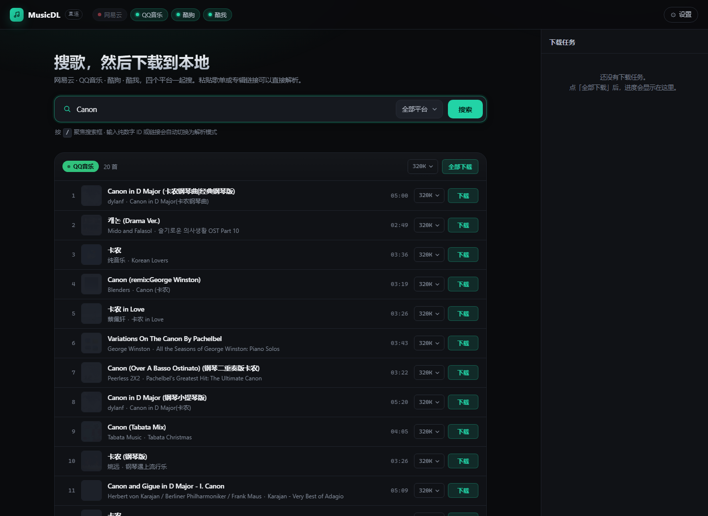
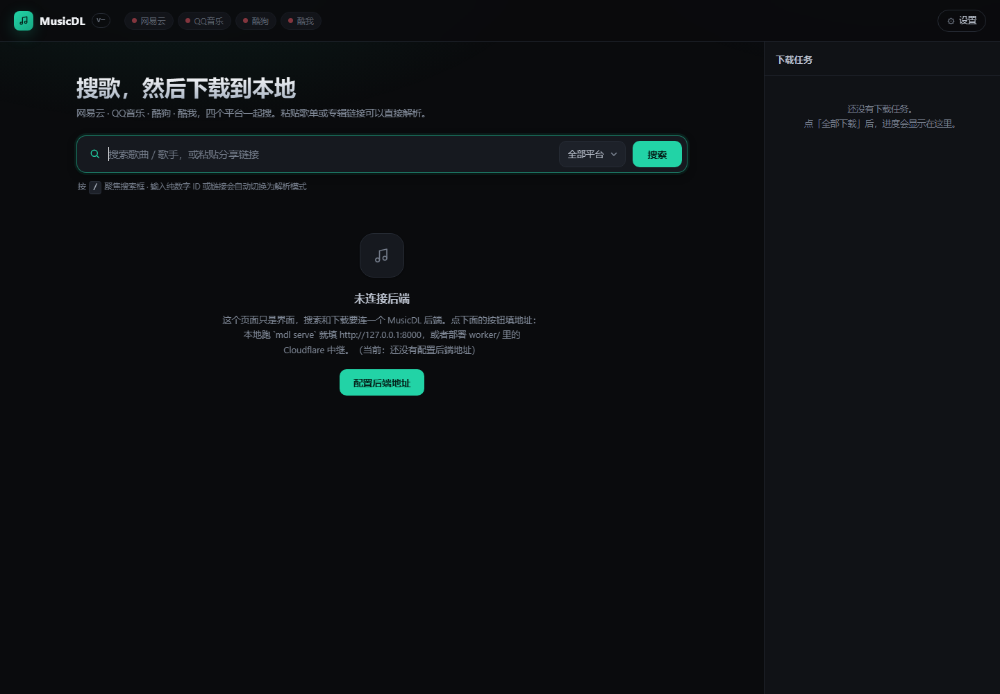

# MusicDL

多平台音乐解析下载器 —— 粘贴一条歌曲 / 歌单 / 专辑链接，解析出曲目并下载到本地，自动写入封面与歌词标签。

支持 **网易云音乐 · QQ音乐 · 酷狗音乐 · 酷我音乐** 四个平台，带 Web 界面和命令行两套入口。

**在线版（GitHub Pages）**：<https://p4rfa1t.github.io/musicdownloader/> —— 纯静态前端，**不用配后端就能搜，酷狗的歌可以直接下载到本地**。要网易云 / FLAC / 封面歌词标签时再填一个后端地址，见 [部署到 GitHub Pages](#部署到-github-pages)。


在线版直连模式（无后端，正在搜「Canon」，酷狗那组可下载）：



配后端后能力全开的样子：



```
┌──────────────┐   ┌──────────────┐   ┌──────────────┐   ┌──────────────┐
│   网易云      │   │   QQ 音乐     │   │    酷狗       │   │    酷我       │
└──────┬───────┘   └──────┬───────┘   └──────┬───────┘   └──────┬───────┘
       └──────────────────┴──────────────────┴──────────────────┘
                                  │
                        ┌─────────▼─────────┐
                        │  Registry 统一抽象  │
                        │ search / resolve  │
                        │ stream / lyric    │
                        └─────────┬─────────┘
                                  │
                    ┌─────────────┴─────────────┐
                    │                           │
              ┌─────▼─────┐              ┌──────▼──────┐
              │  Web UI   │              │     CLI     │
              │ FastAPI   │              │    mdl      │
              └───────────┘              └─────────────┘
```

## 快速开始

```bash
git clone <this-repo> musicdownloader
cd musicdownloader

python -m venv .venv
# Windows
.venv\Scripts\activate
# Linux / macOS
source .venv/bin/activate

pip install -e .
mdl serve --port 8000
```

打开 <http://127.0.0.1:8000> ，输入歌名搜索，或者把链接直接粘进搜索框。

命令行同样可用：

```bash
# 搜索（四平台聚合）
mdl search "晴天 周杰伦"

# 只搜某个平台，取 5 条
mdl search "晴天" -p netease -n 5

# 用链接下载
mdl dl "https://music.163.com/song?id=5257138"

# 用平台 id 下载，指定音质
mdl dl -p netease -i 5257138 -q 320

# 关键词直接下第一条
mdl dl -p kugou -k "Canon 钢琴" -q 128
```

## 支持的链接

| 平台 | 链接形态 | 说明 |
| --- | --- | --- |
| 网易云 | `music.163.com/song?id=xxx` | 单曲 |
| 网易云 | `music.163.com/playlist?id=xxx` | 歌单，整单展开 |
| 网易云 | `music.163.com/album?id=xxx` | 专辑，整张展开 |
| 网易云 | `music.163.com/discover/toplist?id=xxx` | 榜单 |
| QQ音乐 | `y.qq.com/n/ryqq/songDetail/<mid>` | 单曲 |
| QQ音乐 | `i.y.qq.com/v8/playsong.html?songmid=<mid>` | 单曲 |
| 酷狗 | `kugou.com/song/#hash=<32位hash>` | 单曲 |
| 酷狗 | `t1.kugou.com/xxx` 短链 | 跟随跳转后识别 |
| 酷我 | `kuwo.cn/play_detail/<rid>` | 单曲 |

分享文案也能直接粘：`分享周杰伦的单曲《晴天》: https://music.163.com/song?id=186016 (来自@网易云音乐)` —— 会自动抽出 URL。

## 功能

搜索聚合四平台、链接解析（单曲 / 歌单 / 专辑）、批量下载（并发 + 任务进度）、音质选择（128 / 192 / 320 / FLAC）、ID3 标签写入（标题 / 歌手 / 专辑 / 封面 / 歌词）、歌词 LRC 文件、文件名模板、下载目录模板、断点重试、Windows 非法字符清洗、同名文件自动去重。

## 音质与版权

音质档位按平台实际能力回落：请求 320 但平台只给 128 时，会如实返回 128 并标注在结果里。拿不到直链的曲目（付费、会员、下架、地区限制）会返回明确的失败原因，不会静默生成空文件。

实测结论（2026-10，匿名态）：

- **网易云**：搜索、歌词、封面全通；免费曲目给 320k 完整文件，付费曲目只有试听片段或 404。
- **QQ音乐**：搜索、详情、歌词全通；vkey 直链对匿名请求返回空 `purl`，需要登录 Cookie 才有直链。
- **酷狗**：免费曲目直接给完整 mp3（128k），搜索/歌词/封面全通。
- **酷我**：搜索、封面通；匿名态多数曲目只返回约 16KB 试听片段，代码会识别并明确报错。

需要解锁更高音质或更多版权时，填对应平台的 Cookie：

```bash
# Windows PowerShell
$env:MDL_NETEASE_COOKIE="MUSIC_U=xxxxx; __csrf=yyyyy"
$env:MDL_QQ_COOKIE="uin=o123456; qm_keyst=xxxxx"
$env:MDL_KUGOU_COOKIE="kg_mid=xxx; kg_dfid=yyy"
$env:MDL_KUWO_COOKIE="kw_token=xxx"
mdl serve
```

Cookie 从浏览器开发者工具 → Application → Cookies 里复制，属于敏感凭据，别提交进仓库（`.gitignore` 已排除 `.env` 和 `cookies.json`）。

## 配置

全部走环境变量，都有默认值：

| 变量 | 默认 | 说明 |
| --- | --- | --- |
| `MDL_DOWNLOAD_DIR` | `downloads` | 下载根目录 |
| `MDL_CONCURRENCY` | `3` | 批量并发数 |
| `MDL_PROXY` | 空 | HTTP 代理，如 `http://127.0.0.1:7890` |
| `MDL_FILENAME_TEMPLATE` | `{artist} - {title}` | 文件名模板，可用 `{artist}` `{title}` `{album}` `{index}` `{provider}` |
| `MDL_SUBDIR_TEMPLATE` | 空 | 子目录模板，如 `{artist}` 或 `按歌手/{artist}` |
| `MDL_NETEASE_COOKIE` | `os=pc; appver=2.9.7` | 网易云 Cookie |
| `MDL_QQ_COOKIE` | 空 | QQ音乐 Cookie |
| `MDL_KUGOU_COOKIE` | 空 | 酷狗 Cookie |
| `MDL_KUWO_COOKIE` | 空 | 酷我 Cookie |

## HTTP API

服务起来后所有接口都在同源下：

| 方法 | 路径 | 说明 |
| --- | --- | --- |
| GET | `/api/health` | 健康检查 + 平台列表 |
| GET | `/api/search?q=&provider=&limit=` | 聚合搜索，`provider=all` 时并行查四家 |
| POST | `/api/resolve` | `{"url": "..."}` 解析链接 |
| POST | `/api/download` | 下载单曲，同步返回文件信息 |
| POST | `/api/download/batch` | 批量下载，返回 `job_id` |
| GET | `/api/jobs/{id}` | 轮询任务进度 |
| GET | `/api/file?path=` | 取下载目录内的文件（限制在下载根目录内） |

```bash
curl "http://127.0.0.1:8000/api/search?q=晴天&provider=netease&limit=5"
curl -X POST http://127.0.0.1:8000/api/resolve \
     -H "Content-Type: application/json" \
     -d '{"url":"https://music.163.com/song?id=5257138"}'
curl -X POST http://127.0.0.1:8000/api/download \
     -H "Content-Type: application/json" \
     -d '{"provider":"netease","id":"5257138","title":"屋顶","quality":"320"}'
```

## 部署到 GitHub Pages

前端是纯静态的（无构建步骤、无 CDN 依赖），可以直接托管到 GitHub Pages。而且**不配任何后端也能搜索和下载**——走的是纯前端直连模式。

### 不配后端能做什么

实测结论（2026-10）：四个平台的**接口**都不带 CORS 头，但**音频 CDN 大多数带 `Access-Control-Allow-Origin: *`**。所以只要能拿到直链，下载这一步在浏览器里是合法的。

| 平台 | 搜索（JSONP） | 拿直链 | 下载 | 说明 |
| --- | --- | --- | --- | --- |
| 酷狗 | ✅ | ✅ JSONP | ✅ 完整可用 | 免费曲目直接给完整 mp3（128k） |
| QQ音乐 | ✅ | ⚠️ 需登录 | ❌ | vkey 匿名返回空 purl |
| 酷我 | ✅ | ✅ | ❌ | 音频 CDN 不给 CORS |
| 网易云 | ❌ | ❌ | ❌ | 接口既无 JSONP 也无 CORS |

也就是说，**打开 Pages 页面直接搜「Canon」，酷狗那组的结果点下载就会真的存到你电脑里**，全程没有任何服务器参与。这不是"演示版"，是真能用。

网易云是硬边界：它的接口不返回 JSONP 也不返回 CORS 头，浏览器同源策略下拿不到任何数据。想要网易云、FLAC、封面和歌词标签，必须有一个后端。

### 配后端能多出什么

| 功能 | 纯前端直连 | 配后端 |
| --- | --- | --- |
| 搜索 | QQ / 酷狗 / 酷我 | 四平台 |
| 下载 | 酷狗 | 四平台（受版权限制） |
| 音质 | 酷狗 128k | 网易云 320k / FLAC |
| 封面 / 歌词写入标签 | ❌ 浏览器做不到 | ✅ |
| 歌单 / 专辑展开 | ❌ | ✅ |
| 文件名模板、下载目录 | ❌ | ✅ |

三种后端方式：

| 方式 | 后端 | 需要什么 | 适合 |
| --- | --- | --- | --- |
| A | 本地 `mdl serve` | 自己电脑开着服务 | 自己用，最省事 |
| B | Cloudflare Worker 中继 | 一个免费 CF 账号 | 想随时随地打开就能用 |
| C | 任意 VPS / 容器 | 一台服务器 | 长期、多人 |

### 方式 A：本地后端（最快）

```bash
mdl serve --port 8000
```

打开 <https://p4rfa1t.github.io/musicdownloader/>，点右上角「⚙ 设置」，填 `http://127.0.0.1:8000`，点「测试连接」看到绿色「已连接」再保存。之后所有请求都会打到本机。

后端已经默认放行了 Pages 域名和本机端口的 CORS，不用额外配置。要放开别的来源：

```bash
MDL_CORS_ORIGINS="https://your.site,http://192.168.1.10:8000" mdl serve
```

### 方式 B：Cloudflare Worker 中继（推荐）

`worker/worker.js` 是一个无服务器中继，把四个平台的接口代理出来、补上 CORS，并在服务端完成取直链和下载（音频流直接回传浏览器，不落盘不占存储）。

```bash
cd worker
npm i -g wrangler
wrangler login
wrangler deploy worker.js --name mdl-relay --compatibility-date 2024-11-01
```

部署完记下 `https://mdl-relay.<你的子域>.workers.dev`，填进「⚙ 设置」。

免费额度每天 10 万次请求，个人用绰绰有余。想防止别人白嫖，在 Cloudflare 面板给 Worker 加环境变量 `MDL_TOKEN`，之后填地址时带上 `?token=你的令牌`。

中继不支持 `/api/download/batch`（没有持久任务表，返回 501），前端会自动降级成串行逐首下载，任务面板照常显示进度。

### 方式 C：VPS

和方式 A 一样，只是把 `mdl serve` 换成常驻进程，并用 `MDL_CORS_ORIGINS` 放行你的 Pages 域名。

### 自动部署

仓库已配好 `.github/workflows/pages.yml`：推送到 `main` 且改动涉及 `src/mdl/web/**` 时，自动跑 `scripts/build_pages.py` 生成 `docs/` 并发布。

想预置后端地址（这样用户打开就能用，不用自己填）：仓库 Settings → Secrets and variables → Actions → Variables 里加一个 `MDL_API_BASE`，值填你的 Worker 或 VPS 地址。构建时会被注入成 `window.MDL_API_BASE`。

本地预览 Pages 产物：

```bash
python scripts/build_pages.py            # 生成 docs/
python -m http.server 8811 -d docs       # 打开 http://127.0.0.1:8811
```

### 页面上的三种运行状态

页面启动时会先探一次同源的 `/api/health`：

1. 探到了 → 走**后端模式**，能力最全。
2. 探不到，但有 `direct.js` → 自动切**直连模式**，顶栏版本号显示「直连」，平台状态点变成实心/空心区分可用性，酷狗可搜索可下载。
3. 配了地址但连不上 → 先尝试直连兜底，同时 toast 提示，设置弹层里可以改地址。

随时可以在「⚙ 设置」里填后端地址切回后端模式，清空即回到直连模式。

## 项目结构

```
src/mdl/
  config.py            配置、Cookie、CORS 来源
  models.py            Track / StreamInfo / ResolveResult
  http.py              共享 httpx 客户端，重试与超时
  naming.py            文件名与目录模板
  tagger.py            ID3 / MP4 / FLAC 标签写入
  downloader.py        下载引擎 + 批量任务管理
  server.py            FastAPI 路由
  cli.py               命令行入口
  providers/
    base.py            Provider 抽象基类
    netease.py         网易云
    qq.py              QQ音乐
    kugou.py           酷狗
    kuwo.py            酷我
    __init__.py        Provider 注册表 + 链接自动识别
  web/
    index.html         单页界面（相对路径引用资源，可静态托管）
    app.css
    app.js             API_BASE 可配置 + 直连/后端模式切换 + 批量降级
    direct.js          纯前端直连：JSONP 搜索 + CDN 下载（无后端模式）
scripts/
  build_pages.py       生成 docs/ 静态站点
worker/
  worker.js            Cloudflare Worker 中继
  wrangler.toml
docs/                  GitHub Pages 产物（由脚本生成）
tests/
  test_offline.py      离线单测：链接识别、命名、模型
  test_api.py          API 层测试（桩替换网络）+ CORS + 静态资源
  test_live.py         联网集成测试（pytest -m live）
```

## 测试

```bash
# 离线测试，秒级
pytest tests/test_offline.py tests/test_api.py -q

# 联网测试，真实打四个平台
pytest tests/test_live.py -q -m live
```

## 开发

```bash
pip install -e ".[dev]"
uvicorn mdl.server:app --reload --port 8000
```

新增平台：继承 `providers/base.py` 的 `Provider`，实现 `search` / `track_from_id` / `stream`（歌词可选），然后在 `providers/__init__.py` 的 `PROVIDER_CLASSES` 里注册，并在 `_HOST_RULES` 加上域名特征即可。

## 说明

仅供个人学习与本地备份使用。音乐版权归各平台与版权方所有，下载的内容请勿用于传播或商业用途。
