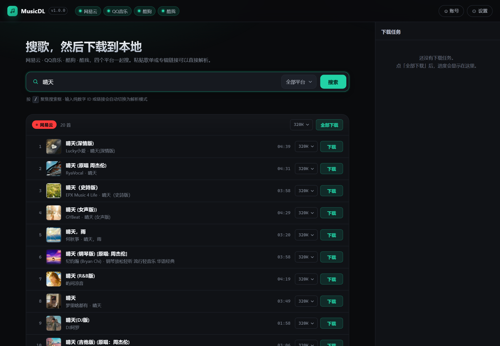
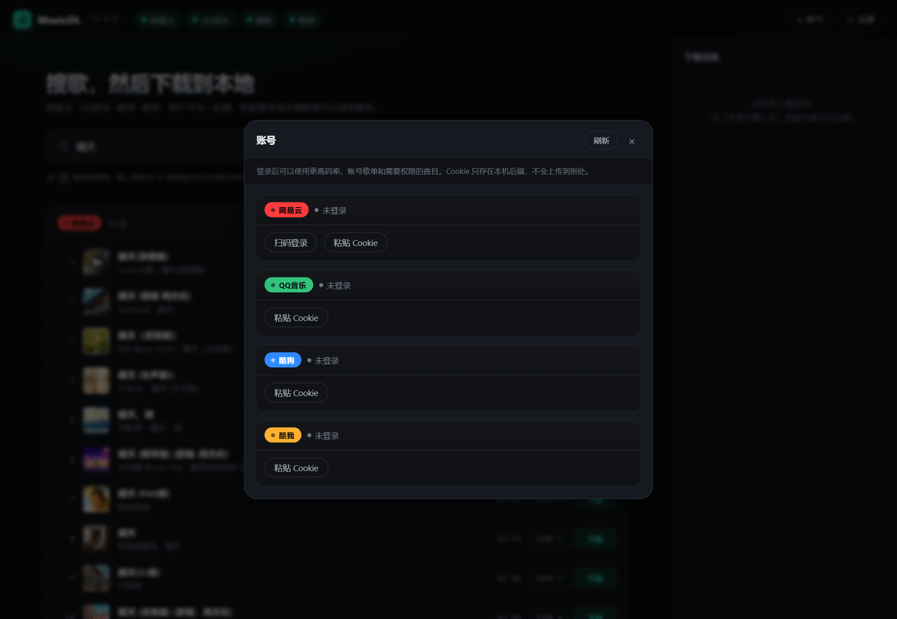

# MusicDL

多平台音乐解析下载器 —— 粘贴一条歌曲 / 歌单 / 专辑链接，解析出曲目并下载到本地，自动写入封面与歌词标签。

支持 **网易云音乐 · QQ音乐 · 酷狗音乐 · 酷我音乐** 四个平台，带 Web 界面和命令行两套入口。Web 界面由后端自己托管，打开就是完整功能，不需要额外部署前端。



账号面板 —— 扫码登录网易云，登录后直接读账号歌单：



```
┌──────────┐  ┌──────────┐  ┌──────────┐  ┌──────────┐
│  网易云   │  │  QQ 音乐  │  │   酷狗    │  │   酷我    │
└────┬─────┘  └────┬─────┘  └────┬─────┘  └────┬─────┘
     └─────────────┴─────────────┴─────────────┘
                         │
               ┌─────────▼─────────┐
               │   Registry 抽象    │   search / resolve
               │                   │   stream / lyric / account
               └─────────┬─────────┘
                         │
              ┌──────────┴──────────┐
        ┌─────▼─────┐         ┌─────▼─────┐
        │  Web UI   │         │    CLI    │
        │  FastAPI  │         │    mdl    │
        └───────────┘         └───────────┘
```

## 快速开始

### 方式一：直接用编译好的程序（不需要装 Python）

从 [Releases](https://github.com/P4rfa1t/musicdownloader/releases) 下载 [`mdl-1.0.0-win64.zip`](https://github.com/P4rfa1t/musicdownloader/releases/download/v1.0.0/mdl-1.0.0-win64.zip)（20.3 MB），解压后：

```
mdl\
├── mdl.exe          双击即可：起服务 + 自动打开浏览器
└── _internal\       依赖和前端资源，必须和 exe 放在一起
```

双击 `mdl.exe` → 浏览器打开 <http://127.0.0.1:8000> → 能搜能下。

也可以当命令行用（在 `mdl\` 目录里开 cmd / PowerShell）：

```bat
mdl.exe search "晴天 周杰伦"
mdl.exe dl "https://music.163.com/song?id=5257138"
mdl.exe serve --port 8080
mdl.exe --help
```

整个 `mdl\` 文件夹可以直接拷到别的机器，不需要装 Python 或任何依赖。

### 方式二：从源码跑

```bash
git clone <this-repo> musicdownloader
cd musicdownloader

python -m venv .venv
# Windows
.venv\Scripts\activate
# Linux / macOS
source .venv/bin/activate

pip install -e .
mdl serve --port 8000
```

打开 <http://127.0.0.1:8000> ，输入歌名搜索，或者把链接直接粘进搜索框。

命令行同样可用：

```bash
# 搜索（四平台聚合）
mdl search "晴天 周杰伦"

# 只搜某个平台，取 5 条
mdl search "晴天" -p netease -n 5

# 用链接下载
mdl dl "https://music.163.com/song?id=5257138"

# 用平台 id 下载，指定音质
mdl dl -p netease -i 5257138 -q 320

# 关键词直接下第一条
mdl dl -p kugou -k "Canon 钢琴" -q 128
```

## 账号登录与歌单

Web 界面右上角「账号」按钮打开账号面板，四个平台各一张卡，状态一目了然（未登录 / 已登录 + 昵称头像 / 已保存 Cookie 但身份未验证）。

| 平台 | 登录方式 | 账号歌单 | 说明 |
| --- | --- | --- | --- |
| 网易云 | 扫码（站内二维码） / 粘贴 Cookie | ✅ 创建 + 收藏的歌单 | 扫完自动拉歌单，点歌单直接展开曲目 |
| QQ音乐 | 粘贴 Cookie | ✅ 全部歌单 | 必须登录才有下载直链（vkey），重点是 `qm_keyst` / `qqmusic_key` |
| 酷狗 | 粘贴 Cookie | ⚠️ 只读公开歌单 | 账号歌单走 App 端签名接口 |
| 酷我 | 粘贴 Cookie | ⚠️ 只读公开歌单 | 站点接口要动态 CSRF token |

**凭据只存在本机**：Cookie 写进项目根目录的 `cookies.json`（已 `.gitignore`），只由本机后端读取，不会发给除对应平台以外的任何地方，也不会出现在任何 API 响应里（有一条测试专门盯着这点）。

**扫码登录（网易云）**：点「扫码登录」→ 面板里出现二维码（由后端生成 base64 PNG，不依赖外部图片服务）→ 用手机网易云 App 扫 → 面板自动轮询状态，扫到（`scanned`）→ 确认（`ok`）→ 头像昵称立刻出现并自动拉歌单。二维码默认 5 分钟过期，界面会显示过期并允许重新生成。

**歌单怎么用**：登录后歌单列表直接出现在卡片里，点任意歌单把曲目灌进主界面的结果区，接着搜索框旁边的「下载全部」就能整单拉下来。也能直接在搜索框粘贴公开歌单链接：

| 平台 | 公开歌单链接 |
| --- | --- |
| 网易云 | `music.163.com/playlist?id=3778678` |
| QQ音乐 | `y.qq.com/n/ryqq/playlist/<disstid>` |
| 酷狗 | `kugou.com/yy/special/single/8268942.html` 或直接填 `specialid` |
| 酷我 | `kuwo.cn/playlist_detail/<pid>` |

平台能力有差异时界面会如实说明，不会假装成功：酷狗/酷我的账号歌单卡片里直接写着「只读公开歌单」，QQ 音乐没登录就会提示「必须登录才能拿直链」。

也可以用环境变量预置 Cookie（适合服务器常驻、不想碰界面的场景），面板里存的会覆盖环境变量：

```bash
# Windows PowerShell
$env:MDL_NETEASE_COOKIE="MUSIC_U=xxxxx; __csrf=yyyyy"
$env:MDL_QQ_COOKIE="uin=o123456; qm_keyst=xxxxx"
$env:MDL_KUGOU_COOKIE="kg_mid=xxx; kg_dfid=yyy"
$env:MDL_KUWO_COOKIE="kw_token=xxx"
mdl serve
```

## 支持的链接

| 平台 | 链接形态 | 说明 |
| --- | --- | --- |
| 网易云 | `music.163.com/song?id=xxx` | 单曲 |
| 网易云 | `music.163.com/playlist?id=xxx` | 歌单，整单展开 |
| 网易云 | `music.163.com/album?id=xxx` | 专辑，整张展开 |
| 网易云 | `music.163.com/discover/toplist?id=xxx` | 榜单 |
| QQ音乐 | `y.qq.com/n/ryqq/songDetail/<mid>` | 单曲 |
| QQ音乐 | `i.y.qq.com/v8/playsong.html?songmid=<mid>` | 单曲 |
| 酷狗 | `kugou.com/song/#hash=<32位hash>` | 单曲 |
| 酷狗 | `t1.kugou.com/xxx` 短链 | 跟随跳转后识别 |
| 酷我 | `kuwo.cn/play_detail/<rid>` | 单曲 |

分享文案也能直接粘：`分享周杰伦的单曲《晴天》: https://music.163.com/song?id=186016 (来自@网易云音乐)` —— 会自动抽出 URL。

## 功能

搜索聚合四平台、链接解析（单曲 / 歌单 / 专辑）、账号登录与歌单读取、批量下载（并发 + 任务进度）、音质选择（128 / 192 / 320 / FLAC）、ID3 标签写入（标题 / 歌手 / 专辑 / 封面 / 歌词）、歌词 LRC 文件、文件名模板、下载目录模板、断点重试、Windows 非法字符清洗、同名文件自动去重。

## 音质与版权

音质档位按平台实际能力回落：请求 320 但平台只给 128 时，会如实返回 128 并标注在结果里。拿不到直链的曲目（付费、会员、下架、地区限制）会返回明确的失败原因，不会静默生成空文件。

实测结论（2026-10，匿名态）：

- **网易云**：搜索、歌词、封面全通；免费曲目给 320k 完整文件，付费曲目只有试听片段或 404。
- **QQ音乐**：搜索、详情、歌词全通；vkey 直链对匿名请求返回空 `purl`，需要登录 Cookie 才有直链。
- **酷狗**：免费曲目直接给完整 mp3（128k），搜索/歌词/封面全通。
- **酷我**：搜索、封面通；匿名态多数曲目只返回约 16KB 试听片段，代码会识别并明确报错。

登录后能解锁的范围：QQ 音乐有直链、网易云会员曲不再被截成 45 秒试听、部分平台码率抬到请求档位。

## 配置

全部走环境变量，都有默认值：

| 变量 | 默认 | 说明 |
| --- | --- | --- |
| `MDL_DOWNLOAD_DIR` | `downloads` | 下载根目录 |
| `MDL_CONCURRENCY` | `3` | 批量并发数 |
| `MDL_PROXY` | 空 | HTTP 代理，如 `http://127.0.0.1:7890` |
| `MDL_FILENAME_TEMPLATE` | `{artist} - {title}` | 文件名模板，可用 `{artist}` `{title}` `{album}` `{index}` `{provider}` |
| `MDL_SUBDIR_TEMPLATE` | 空 | 子目录模板，如 `{artist}` 或 `按歌手/{artist}` |
| `MDL_NETEASE_COOKIE` | `os=pc; appver=2.9.7` | 网易云 Cookie |
| `MDL_QQ_COOKIE` | 空 | QQ音乐 Cookie |
| `MDL_KUGOU_COOKIE` | 空 | 酷狗 Cookie |
| `MDL_KUWO_COOKIE` | 空 | 酷我 Cookie |
| `MDL_CORS_ORIGINS` | 本机端口 | 额外放行的跨域来源，逗号分隔 |

## HTTP API

服务起来后所有接口都在同源下：

| 方法 | 路径 | 说明 |
| --- | --- | --- |
| GET | `/api/health` | 健康检查 + 平台列表 |
| GET | `/api/search?q=&provider=&limit=` | 聚合搜索，`provider=all` 时并行查四家 |
| POST | `/api/resolve` | `{"url": "..."}` 解析链接 |
| POST | `/api/download` | 下载单曲，同步返回文件信息 |
| POST | `/api/download/batch` | 批量下载，返回 `job_id` |
| GET | `/api/jobs/{id}` | 轮询任务进度 |
| GET | `/api/file?path=` | 取下载目录内的文件（限制在下载根目录内） |
| GET | `/api/accounts` | 四个平台的登录状态（一次拿全） |
| POST | `/api/accounts/{platform}` | `{"cookie": "..."}` 保存并校验 Cookie |
| DELETE | `/api/accounts/{platform}` | 退出登录，清掉本地凭据 |
| POST | `/api/accounts/{platform}/qr` | 申请登录二维码，返回 data URL 图片 |
| GET | `/api/accounts/{platform}/qr/{key}` | 轮询扫码状态（wait / scanned / ok / expired） |
| GET | `/api/accounts/{platform}/playlists` | 当前账号的歌单 |
| GET | `/api/playlists/{platform}/{id}` | 公开歌单曲目 |

```bash
curl "http://127.0.0.1:8000/api/search?q=晴天&provider=netease&limit=5"
curl -X POST http://127.0.0.1:8000/api/resolve \
     -H "Content-Type: application/json" \
     -d '{"url":"https://music.163.com/song?id=5257138"}'
curl -X POST http://127.0.0.1:8000/api/download \
     -H "Content-Type: application/json" \
     -d '{"provider":"netease","id":"5257138","title":"屋顶","quality":"320"}'

# 账号：申请二维码 → 轮询 → 读歌单
curl -X POST http://127.0.0.1:8000/api/accounts/netease/qr
curl "http://127.0.0.1:8000/api/accounts/netease/qr/<key>"
curl "http://127.0.0.1:8000/api/accounts/netease/playlists"
```

## 项目结构

```
src/mdl/
  config.py            配置、Cookie、CORS 来源
  models.py            Track / StreamInfo / ResolveResult / AccountInfo / Playlist
  http.py              共享 httpx 客户端，重试与超时，按平台挂 Cookie
  accounts.py          账号凭据存储（cookies.json，原子写、脱敏）
  qr.py                二维码生成（qrcode + Pillow，缺依赖时降级）
  naming.py            文件名与目录模板
  tagger.py            ID3 / MP4 / FLAC 标签写入
  downloader.py        下载引擎 + 批量任务管理
  server.py            FastAPI 路由（曲目 / 下载 / 账号 / 歌单）
  cli.py               命令行入口
  entry.py             打包后的程序入口
  providers/
    base.py            Provider 抽象基类（含账号与歌单能力声明）
    netease.py         网易云（扫码登录 + 账号歌单）
    qq.py              QQ音乐（Cookie 登录 + 账号歌单）
    kugou.py           酷狗（Cookie + 公开歌单）
    kuwo.py            酷我（Cookie + 公开歌单）
    __init__.py        Provider 注册表 + 链接自动识别
  web/
    index.html         单页界面（资源全部相对路径，由后端托管）
    app.css
    app.js             搜索 / 解析 / 批量下载 / 任务面板
    account.js         账号面板：登录、扫码轮询、歌单
    account.css
scripts/
  build_exe.py         编译可执行程序 + 冒烟测试 + 打 zip
mdl.spec               PyInstaller 配置
tests/
  test_offline.py      离线单测：链接识别、命名、模型
  test_api.py          API 层测试（桩替换网络）+ CORS + 静态资源
  test_accounts.py     账号层：凭据存储脱敏、登录/扫码/歌单路由契约
  test_live.py         联网集成测试（pytest -m live）
```

## 测试

```bash
# 离线测试，秒级
pytest tests/test_offline.py tests/test_api.py tests/test_accounts.py -q

# 联网测试，真实打四个平台
pytest tests/test_live.py -q -m live
```

## 编译成可执行文件

后端可以打包成不依赖 Python 的独立程序：

```bash
pip install pyinstaller
python scripts/build_exe.py
```

产物：

| 路径 | 说明 |
| --- | --- |
| `dist/mdl/mdl.exe` | 主程序 |
| `dist/mdl/_internal/` | 依赖 + 前端静态资源（必须一起分发） |
| `dist/mdl-1.0.0-win64.zip` | 打好的压缩包，20 MB 左右 |

脚本会自动做冒烟测试（跑 `--version`、检查前端资源是否打进包），不合格直接报错退出。

关于「为什么不是单文件 exe」：本机 **Python 3.14.6 + PyInstaller 6.22.3** 的组合下，`--onefile` 的 bootloader 必定报错——

```
[PYI-xxxx:ERROR] Could not create temporary directory!
```

用 hello world 最小样例就能复现，`onedir` 完全正常，所以是工具链的坑，不是项目代码的问题。目录模式还有个附带好处：启动不用每次解压到 `%TEMP%`，常驻服务更合适，也不会被杀软反复扫描。

换低版本 Python（3.11–3.13）后 `--onefile` 应该能用，改 `mdl.spec` 里的 `EXE`/`COLLECT` 两段即可。

`.github/workflows/build-exe.yml` 是手动触发的 CI 构建（Actions 页面点 Run workflow），产物作为 artifact 上传；勾选 `attach_release` 时会挂到同名 Release。日常发版用本地 `scripts/build_exe.py` 出包，再用 API 上传，避免 CI 和本地产生两份同名产物互相覆盖。

上传 20 MB 的包到 `uploads.github.com` 在这台机器上很慢（实测约 25 KB/s，14 分钟），命令行的 `timeout` 要给够，否则会出现「写超时」而不是真正的失败。

## 开发

```bash
pip install -e ".[dev]"
uvicorn mdl.server:app --reload --port 8000
```

新增平台：继承 `providers/base.py` 的 `Provider`，实现 `search` / `track_from_id` / `stream`（歌词、账号、歌单可选），然后在 `providers/__init__.py` 的 `PROVIDER_CLASSES` 里注册，并在 `_HOST_RULES` 加上域名特征即可。账号相关能力有四个类属性声明：`login_modes`（`qr` / `cookie`）、`playlists_supported`、`account_note`、以及可选的 `qr_start` / `qr_poll` 实现。

## 说明

仅供个人学习与本地备份使用。音乐版权归各平台与版权方所有，下载的内容请勿用于传播或商业用途。